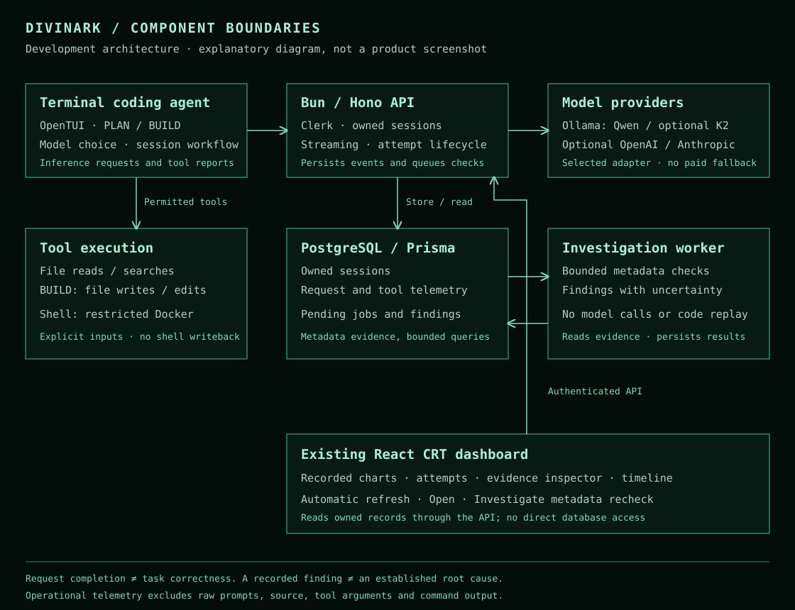

# Divinark AI

**A terminal coding agent with evidence-based investigation of execution failures.**

Divinark connects a PLAN/BUILD coding workflow to recorded inference and tool events. Its reliability work asks a specific question: **what does the available evidence actually establish when an agent run goes wrong?**

This is a documentation-first showcase of an early development project. It contains original technical documentation and an architecture diagram, not an installable application or a stable software release. The capabilities below describe the inspected development snapshot; the latest reliability and K2 integrations remain under review and are not merged into the application's stable branch.

## What is implemented

| Area | Current behavior | Evidence and limits |
| --- | --- | --- |
| Terminal coding workflow | PLAN exposes read-only file tools; BUILD adds file writes, edits and restricted shell execution. Saved sessions and a model selector are implemented. | Controlled workflow and permission tests exercise these paths. A completed response does not verify a coding task. |
| Local inference | Ollama integration supports Qwen2.5-Coder 3B, Qwen3.5 9B and the optional K2 Horizon 7B Q4_K_M alias. Qwen2.5-Coder 3B remains the default. | K2 streamed text has been observed on a local Mac. Native K2 tool execution and a same-task Qwen comparison remain unverified. |
| Optional cloud inference | OpenAI and Anthropic adapters remain available alongside local models. | Credentials are required for the selected cloud provider. Local-provider errors do not silently select a paid model. |
| Execution telemetry | Request-level attempt IDs link inference outcomes, durations, available token counts and reported tool invocations. | Missing measurements stay unavailable. Client tool reports are observations, not independently attested execution. |
| Automatic investigation | Inference and tool events enqueue bounded, deterministic checks. Findings identify supporting events, missing information and unverified explanations. | The current investigator checks operational metadata. It does not establish arbitrary task correctness or a deeper causal root cause. |
| Reliability dashboard | The existing retro CRT dashboard displays recorded outcomes, token coverage, attempt timelines and investigation details. | Open inspects evidence; Investigate requests a metadata recheck. No model-performance statistics are invented. |

## Architecture

The diagram describes component boundaries. It is not a screenshot or a performance result. See [architecture](docs/architecture.md) for execution and data-access limits.

## Screenshots and demonstrations

The application retains its existing dark CRT console, green accents, avatar, charts and terminal interface. This showcase makes no application or design changes.

Screenshots are withheld from this initial package: the available captures contain browser identity details, internal addresses or operational identifiers, and visual-asset redistribution has not been cleared. No replacement artwork or fabricated terminal output is used. The [media checklist](media/README.md) defines what a publishable capture must satisfy.

Read the [demonstration record](demo/README.md) for the observations available so far and their limits. This repository cannot launch the application; no public binary, hosted demo, application source or model weights are distributed here.

## Technology

Bun · TypeScript · Hono · React · Vite · OpenTUI · PostgreSQL · Prisma · Clerk · Ollama · Docker for restricted shell execution. OpenAI and Anthropic are optional inference providers.

Dependencies and model names describe integrations, not affiliation or endorsement.

## Status and next work

Reviewed **1 November 2026**. Controlled software checks and limited local smoke observations support the implementation descriptions; they do not establish diagnostic accuracy, a model ranking or production readiness. See the [status and verification table](docs/current-status.md).

Next priorities are to finish native tool smoke checks, observe automatic investigation across a complete live task, and add explicitly authorized task-level evidence. Independent evaluation comes after those product checks. See the [roadmap](docs/roadmap.md).

## Read more

- [Project overview](docs/overview.md)
- [Architecture and privacy boundaries](docs/architecture.md)
- [Current status and known limitations](docs/current-status.md)
- [Roadmap](docs/roadmap.md)
- [Manual public-update workflow](docs/public-updates.md)
- [Publication scope and rights](RIGHTS.md)

This repository has its own history and receives manually reviewed updates. It contains no development-repository history, private experiment bundles or automatic mirror.
