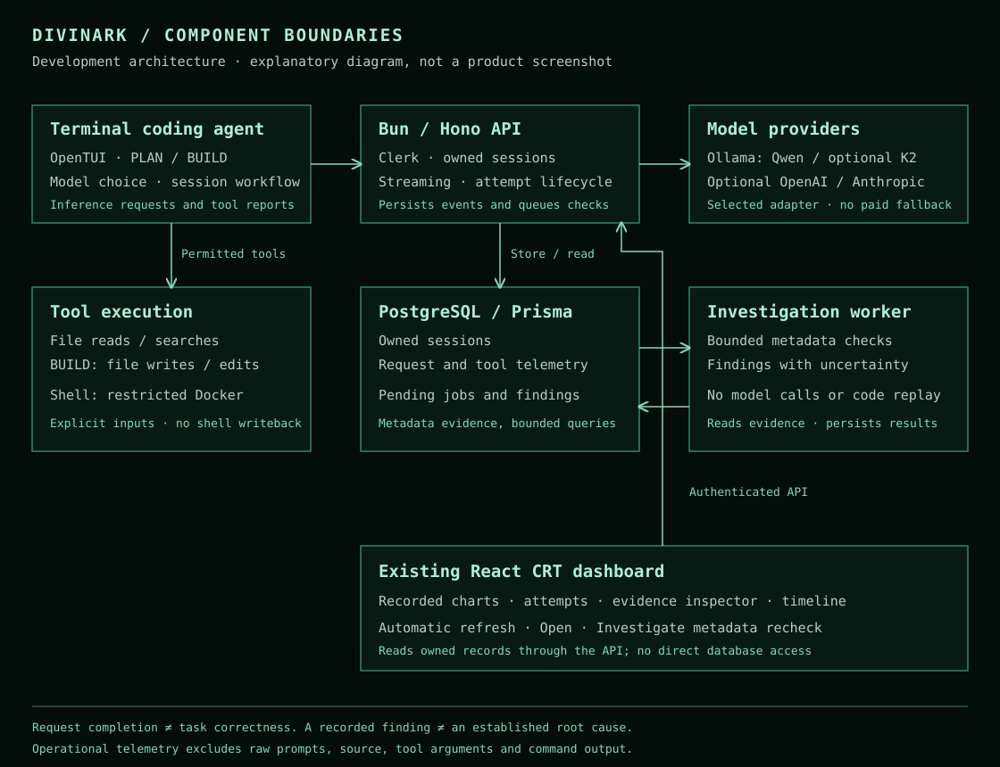

# Architecture

This document describes the inspected development implementation, not a released installation guide.

## Terminal, models and tools

The OpenTUI terminal uses the existing model selector and PLAN/BUILD workflow. Hono streams inference responses through the selected provider. Local inference uses Ollama; optional cloud adapters require their own configuration. Provider errors, interruption and local inference deadlines are recorded separately. Model-shaped text is not treated as an executed tool call.

PLAN permits file reads, directory listing and file searches. BUILD also exposes file writes and exact-match edits. These file operations act on the working project; they are separate from shell execution. Mode checks and input validation apply before execution. These controls are not a claim that every filesystem access path has received a security audit.

Shell commands use the restricted Docker execution boundary. The implementation checks a pinned runtime image and container restrictions, including a non-root user, network isolation, resource limits and a read-only root filesystem. Only explicitly selected input files are staged. Shell changes are not written back to the working project, and there is no automatic host-shell fallback. A boundary or cleanup problem prevents further shell work. These controls reduce exposure; they are not a formal security proof.

## Evidence and investigations

The server assigns an inference attempt ID. CLI tool invocation IDs link reported executions to that request and its owned session. A continuation request receives another attempt ID: the current unit of investigation is a request, not a complete multi-request task.

Inference lifecycle changes and tool reports enqueue persisted investigation work. A bounded in-process worker reads the relevant metadata and stores a revision-checked result. Pending work can resume after a restart. This path does not call an explanation model, import generated source, replay an experiment or execute a recovery command.

The deterministic investigator checks reported failures, cancellation, nonzero exits and bounded failure categories such as timeout, missing path, invalid input or edit-precondition failure. It associates findings with evidence IDs and records unresolved information. At present, task correctness remains not evaluated and deeper root cause remains not established.

The React dashboard periodically refreshes recorded attempts and investigations. Open shows the evidence inspector; Investigate queues a metadata recheck. The existing CRT appearance and outcome/token charts remain part of the application.

## Data and access boundaries

Clerk authentication and session ownership scope API access. PostgreSQL stores sessions, inference telemetry, tool telemetry and investigation records through Prisma.

Operational telemetry uses bounded metadata: provider/model identity, timing, outcomes, available token counts and normalized tool failure categories. It does not silently retain raw prompts, source files, tool arguments, command output or exception text. Saved chat history is a separate application feature; this is not a claim that the application never stores conversation content.

Tool reports originate from the client and are not independent attestation. Missing reports do not prove that no tool ran. An open attempt may be active or stale. Future deeper artifact capture requires a separate, explicit authorization and retention design; the current investigator does not inspect private source automatically.
